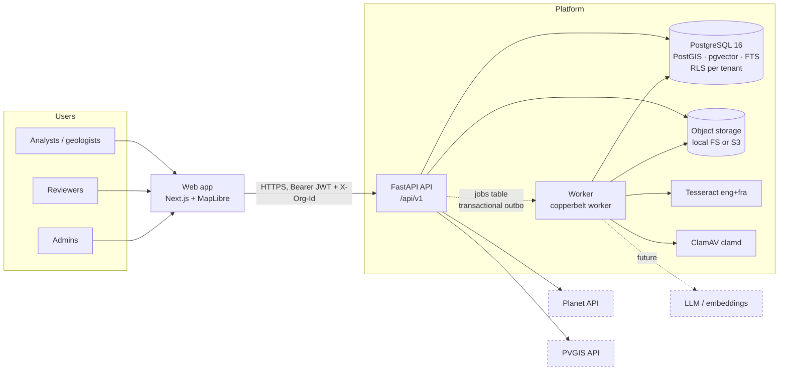
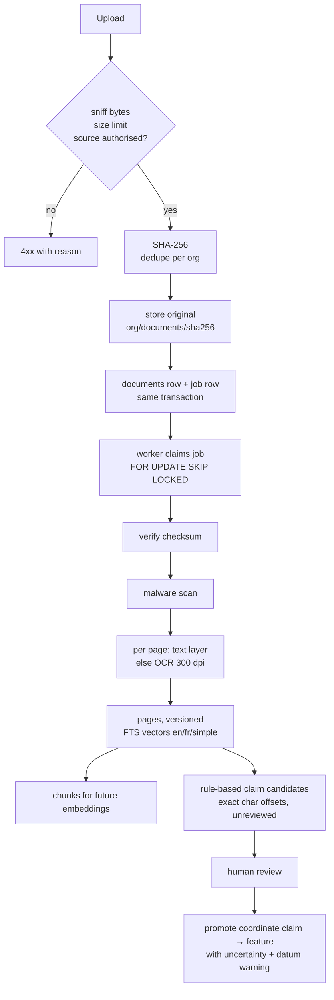
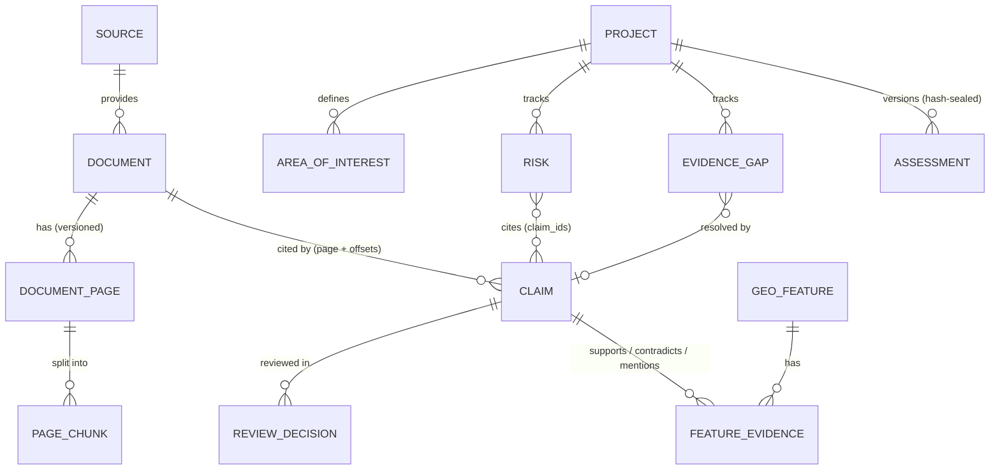

# Architecture

## System context



## Request path and tenant isolation

```mermaid
sequenceDiagram
  participant C as Client
  participant M as Middleware
  participant D as ctx() dependency
  participant S as Session (app role)
  participant P as PostgreSQL
  C->>M: request + Bearer + X-Org-Id
  M->>M: request id, rate limit, security headers
  M->>D: route
  D->>P: verify token version, active membership (system session)
  D->>S: new session(org_id)
  S->>P: BEGIN; set_config('app.org_id', org, true)
  S->>P: queries filtered by org_id (app layer)
  P-->>S: rows also filtered by RLS policy
  D->>P: COMMIT (audit event in same transaction)
```

Both layers are tested independently: `test_cross_tenant_access_is_denied` (API) and `test_row_level_security_blocks_cross_tenant_rows_in_the_database` (connects as the app role and bypasses the application).

## Document pipeline



## Evidence model (core entities)



Separation of kinds of knowledge (core principle): **observed facts** are claims with `evidence_basis` = field_observation / laboratory_result / independently_verified; **extracted claims** carry `extraction_method` + `extractor_version` + `confidence`; **calculated indicators** live in the dossier's `evidence_quality`; **assumptions and professional judgements** are risks (analyst-scored) and the assessment's `reviewer_conclusion`, which is required to approve and labelled as human judgement.

## Module layout

```
backend/src/copperbelt/
  config.py db.py storage.py errors.py main.py cli.py
  models/       identity · ops (audit, jobs, idempotency, provider checks/usage) · evidence · projects
  security/     auth (argon2id, JWT) · permissions (role → permission) · deps (request context)
  ingestion/    validation · extract (pdfium + tesseract) · vocabulary (en/fr commodities) · rules
  jobs/         queue (outbox, SKIP LOCKED, backoff, dead-letter, stale-lock recovery)
  search/       hybrid FTS + trigram + spatial
  geo/          CRS transform, validation, geodesic area, uncertainty defaults
  providers/    base (honest status) · planet · pvgis · registry (LLM/embedding slots)
  services/     documents · evidence · projects · access · audit
  api/v1/       auth · org · documents · evidence (claims, features, search, geo, AOI) · projects · providers
```

The backend is a modular monolith (ADR 0001). Modules communicate through service functions, not HTTP, and share one transaction per request. A module can be extracted when it has a distinct scaling or security boundary (satellite processing is the likely first candidate).
